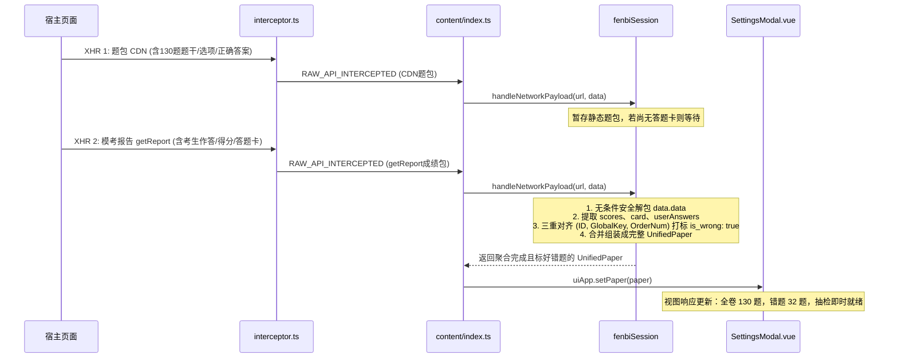

# 公考内容排版插件 · 架构设计与工程开发规范

> **版本**：v1.0.0  
> **核心原则**：KISS（Keep It Simple, Stupid）· 单一职责（SRP）· 第一性原理（First Principles）  
> **适用范围**：`extension/` 目录下所有前端扩展代码（含 Main World 拦截器、Content Script、Adapters、UI 展现层与 Background Service Worker）。

---

## 一、 架构全景与分层设计

为了彻底杜绝**跨层渗透**与**重复打补丁**，插件采用严格的四层单向数据流架构：

```mermaid
graph TD
    subgraph Layer1["1. 宿主网络感知层 (Main World)"]
        INJ["interceptor.ts<br>• 原生 fetch / XHR 透明 Hook<br>• SPA 路由无感监听<br>• 纯网络管道，零业务逻辑"]
    end

    subgraph Layer2["2. 路由与调度中枢 (Isolated World)"]
        CS["content/index.ts<br>• 挂载悬浮卡片与交互弹窗<br>• 根据域名与请求特征进行平台分流<br>• 调度 Adapter 输出 UnifiedPaper"]
    end

    subgraph Layer3["3. 平台专属适配器内核 (Adapters)"]
        FB["adapters/fenbi/<br>• session.ts (模考双包聚合/成绩报告)<br>• dom.ts (屏幕兜底)<br>• normalize.ts (题干/符号清洗)"]
        HT["adapters/huatu/<br>• 华图专项/模考适配器"]
        SKB["adapters/shikaobang/<br>• 事考帮富文本Delta解析器"]
    end

    subgraph Layer4["4. 表现层与后端排版交付"]
        UI["content/ui/ (Vue 3)<br>• SettingsModal.vue (排版交互)<br>• FloatingWidget.vue (悬浮球)<br>• 只消费纯净 UnifiedPaper"]
        BG["background/index.ts<br>• 跨域下载 / Token 管理<br>• 提交后端 /api/v1/render-books/"]
    end

    INJ -->|RAW_API_INTERCEPTED (原汁原味)| CS
    CS -->|分发粉笔流量| FB
    CS -->|分发华图流量| HT
    CS -->|分发事考帮流量| SKB
    FB -->|输出标准化 UnifiedPaper| CS
    HT -->|输出标准化 UnifiedPaper| CS
    SKB -->|输出标准化 UnifiedPaper| CS
    CS -->|绑定试卷并驱动视图| UI
    UI -->|排版请求| BG
```

---

## 二、 各层职责规范与开发红线 (Dos and Don'ts)

### 1. 宿主网络感知层 (`src/content/interceptor.ts`)
- **运行环境**：宿主网页上下文（`"world": "MAIN"`）。
- **核心职责**：
  - 透明拦截原生 `fetch` 与 `XMLHttpRequest`；
  - 拦截 `history.pushState`、`replaceState` 与 `hashchange` 感知单页应用切换；
  - 凡是符合白名单规则的 JSON 请求，原样派发 `RAW_API_INTERCEPTED` 广播。
- **🚫 严禁事项（开发红线）**：
  - **严禁编写特定平台的解析算法**：绝对不准在拦截器中写错题判定、选项比对、字段清洗；
  - **严禁修改请求或篡改响应**：嗅探必须完全静默、只读；
  - **保持极致精炼**：代码量必须控制在 200 行以内，杜绝臃肿。

### 2. 调度层 (`src/content/index.ts`)
- **运行环境**：插件独立沙箱（Isolated World）。
- **核心职责**：
  - 挂载 UI（`FloatingWidget` 与 `SettingsModal`）；
  - 监听 `RAW_API_INTERCEPTED`，依据 URL 域名精准派发给对应平台的 Adapter 处理；
  - 接收 Adapter 输出的标准化 `UnifiedPaper`，通知 UI 渲染；
  - 在 SPA 路由切换时调用 `session.reset()` 避免脏数据交叉污染。
- **🚫 严禁事项**：
  - **严禁在调度层堆砌具体题库的字段解析**；
  - 所有平台个性化状态由各平台的 Session 内部管理。

### 3. 平台专属适配器内核 (`src/adapters/<platform>/`)
- **定位**：各题库平台混乱数据结构的**唯一净化清洗厂**。
- **核心职责**：
  - 将异构字段映射为系统统一的 `UnifiedPaper` 数据契约；
  - 管理异步多包聚合（如粉笔模考的“静态 130 题 CDN 包”与“动态 `getReport` 成绩卡包”）；
  - 错题打标：准确为错题赋予 `q.is_wrong = true`；
  - 降级兜底：当网络包缺失时，提供从当前 DOM 提取题目的保底实现。
- **高内聚原则**：
  - 任何针对粉笔的 Bug 修复或特性调整，**代码必须 100% 封闭在 `src/adapters/fenbi/` 内部**，不得外溢。

### 4. 表现层 (`src/content/ui/`)
- **定位**：纯粹的展示与用户交互层（Vue 3 + Tailwind/自定义组件）。
- **核心职责**：
  - 接收 `UnifiedPaper`，渲染试卷信息、题量统计与健康度抽检；
  - 提供真题/模考错题/错题突破的导出模式切换；
  - 搜集排版设置项（纸张、字体、字号、加粗、答案编排方式）并触发导出。
- **🚫 严禁事项**：
  - **严禁包含平台特异性逻辑**：UI 只认 `paper.sections` 与小题的 `is_wrong: true`，绝不准在 UI 层根据特定平台的原始 ID 或字段做二次过滤。

### 5. ⚡ 全局最高铁律：零主动外部网络请求原则 (Zero Outgoing Network Requests)
- **核心铁律**：插件在任何做题、模考、真题解析页面，**严禁主动向宿主平台（粉笔/华图/事考帮官方接口）发起任何 HTTP fetch / XHR 探测或重试请求**！
- **设计初衷与第一性原理**：
  1. **防范风控与账号安全**：宿主平台具备严格的频控与爬虫检测，插件主动发起的非官方行为容易招致验证码或账号拦截；
  2. **避免控制台网络噪音**：用户使用 DevTools 审计或查看网络时，插件发出的多余请求会造成混淆与不信任；
  3. **职责纯粹性**：网页前端本就会为了渲染试卷与报告发起标准请求，插件注入的 `injected.js` 能够 100% 完整透明拦截所有数据，无需多此一举。
- **降级机制**：若因热重载漏掉网络包，仅通过 `injected.js` 内存重播或纯净 DOM 扫描兜底，决不允许以发请求的方式“抢救”。

---

## 三、 统一数据契约 (`UnifiedPaper`)

所有 Adapter 输出的数据，必须严格遵守以下契约规范：

```typescript
export interface UnifiedPaper {
  title: string                     // 试卷正式大标题 (如: 2027年国考行测模考大赛第三十六季)
  source_platform: 'fenbi' | 'huatu' | 'shikaobang' // 题库来源
  total_questions: number           // 题目总数量
  sections: UnifiedSection[]        // 大题模块分卷
  metadata?: {
    exam_id?: string | number       // 平台原始试卷ID
    scene?: 'paper' | 'mistake' | 'mock_exam' // 场景标识
    isMockExam?: boolean            // 是否为模考大赛
    totalWrong?: number             // 做错题目总数
    wrongQuestionIds?: number[]     // 错题数字ID列表
    wrongQuestionKeys?: string[]    // 错题GlobalKey列表 (如 3_1_chpbl)
    wrongQuestionOrders?: number[]  // 错题原卷序号列表 (1-based)
    [key: string]: any
  }
}

export interface UnifiedSection {
  name: string                      // 模块名称 (如: 常识判断, 言语理解与表达)
  description?: string              // 模块作答说明
  questions: UnifiedQuestion[]      // 小题列表
}

export interface UnifiedQuestion {
  id: number | string               // 题目唯一主键
  question_id?: number | string
  order_num: number                 // 卷面题号 (从 1 递增)
  type: 'single_choice' | 'multiple_choice' | string
  stem: string                      // 清洗后的题干富文本 HTML
  options: string[]                 // 选项数组 (标准清洗: 去除 A./B./A、等冗余前缀)
  answer?: string                   // 标准参考答案 (如: 'A', 'B', 'ABCD')
  user_answer?: string              // 考生实际作答 (如: 'B')
  analysis?: string                 // 名师深度解析 HTML
  material?: string                 // 复合题公共资料/材料 HTML
  source?: string                   // 真题来源 (如: 2026年国考行政执法卷第12题)
  is_wrong?: boolean                // ★核心标记: 该题是否做错 (UI据此一键精准过滤)
}
```

---

## 四、 模考「双包聚合与错题判定」标准流程

粉笔等平台模考采用“题卡分离”架构，适配器（如 `FenbiSessionManager`）需严格遵循以下聚合流水线：



---

## 五、 如何接入一个新题库平台

若后续需接入某新公考平台（例如中公网校、腰果公考等），只需 3 步即可规范化接入：

### 第 1 步：配置域名白名单
1. 在 `extension/public/manifest.json` 的 `host_permissions` 与 `content_scripts.matches` 中追加该平台域名；
2. 在 `src/content/interceptor.ts` 的 `isTargetExamUrl` 列表中追加其 API 识别路径。

### 第 2 步：创建专属适配器目录 (`src/adapters/<platform>/`)
新建独立目录，包含：
- `index.ts`：实现 `adapt<Platform>Paper(raw, settings): UnifiedPaper`；
- `normalize.ts`：实现专属的选项清洗、数学公式清洗与反向陷阱词加粗；
- `dom.ts`：实现屏幕 DOM 提取兜底函数。

### 第 3 步：在 `src/content/index.ts` 注册流量分发
在 `RAW_API_INTERCEPTED` 监听器中追加平台路由分支：
```typescript
const isNewPlatform = lowerUrl.includes('newplatform.com') || location.href.includes('newplatform.com')
if (isNewPlatform) {
  currentUnifiedPaper = adaptNewPlatformPaper(data, DEFAULT_TYPOGRAPHY_SETTINGS)
  if (currentUnifiedPaper) uiApp?.setPaper(currentUnifiedPaper)
  return
}
```

---

## 六、 本地调试与构建发布

### 1. 构建命令
```bash
# 进入扩展工程目录
cd D:\100_Work\101_Program\Proj\fba\extension

# 依赖安装 (使用 pnpm)
pnpm install

# 生产构建 (检查 TS 类型并执行 Vite 打包)
pnpm run build
```
构建产物输出于 `extension/dist`。

### 2. Chrome / Edge 扩展重新载入流程
1. 打开浏览器扩展管理页面：`chrome://extensions/`；
2. 确保右上角开启 **【开发者模式】**；
3. 点击本插件卡片右下角的 **🔄 刷新** 按钮；
4. 回到题库网页，按 **F5** 刷新页面完成测试。

### 3. 开发者调试建议
- **网络拦截诊断**：打开控制台，搜索 `[公考网络嗅探引擎]` 或 `[粉笔适配器]` 即可查看实时捕获的请求流与聚合状态；
- **页面状态检查**：在宿主环境控制台输入 `window.__GONGKAO_LATEST_EXAM__` 可直接读取当前捕获的最新试卷对象。
